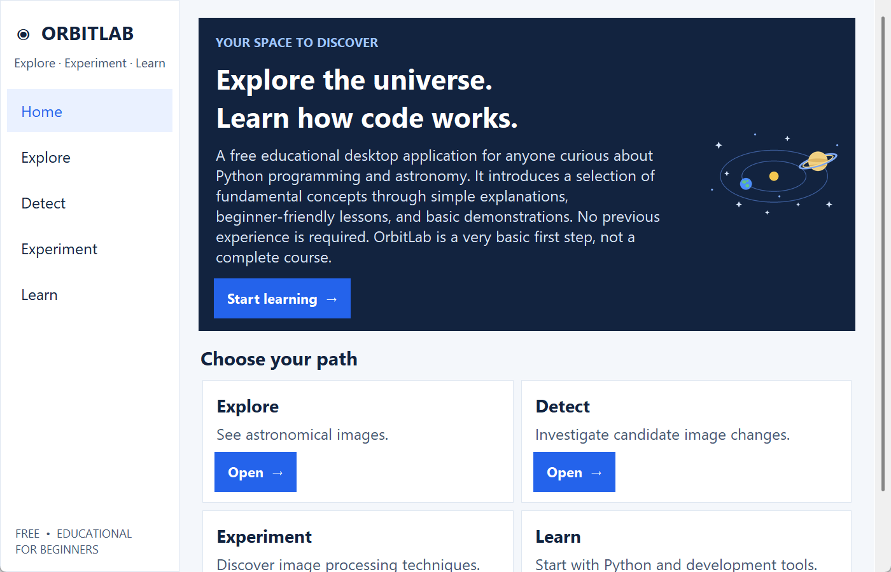

# OrbitLab

### A Free Beginner's Guide to Python and Astronomy

OrbitLab is a free educational desktop application for anyone curious about Python programming and astronomy. It introduces a selection of fundamental concepts through simple explanations, beginner-friendly lessons, and basic demonstrations. No previous experience is required.

OrbitLab is a very basic introduction. It is a starting point for curious beginners. Its purpose is to introduce a few fundamental ideas, encourage curiosity, and help you take your first steps. It is not a complete Python course, a comprehensive astronomy course, or professional software. Finishing it does not make you proficient in Python or astronomy.

## Educational Purpose and Limitations

OrbitLab is a free, beginner-friendly educational project designed to introduce basic Python programming and astronomy concepts. Its activities are learning demonstrations, not professional scientific analysis tools. Highlighted image changes are unverified candidates and do not represent confirmed astronomical discoveries. Some activities require external telescope datasets.

OrbitLab is also not a complete Python course or a comprehensive astronomy course. It covers only a few first, basic ideas.

## What OrbitLab teaches

- How to set up Python on Windows.
- The basics of Python: variables, decisions, loops and functions.
- How to use libraries.
- How a digital image is a grid of numbers.
- What a telescope image file (FITS) is.
- Why a detected change is not the same as a discovery.
- The basics of Git and GitHub.

## The 10 lessons

1. What to install
2. Python basics
3. Conditions and loops
4. Functions and errors
5. Libraries and imports
6. Images and computer vision
7. Astronomy and FITS
8. What does detection mean?
9. Git and GitHub
10. Build your own experiment

## Astronomy demonstrations

- **Explore:** view an astronomical image of the Horsehead Nebula, and a sequence of four demonstration images. *(Needs external data.)*
- **Detect:** see unverified candidate brightness changes in the sequence. *(Needs external data.)*
- **Experiment:** compare two images and filter out noise *(needs external data)*, and simulate movement *(needs no extra files: it makes its own artificial star field)*.

These are learning demonstrations, not scientific analysis.

## Tested versions

OrbitLab has only been tested on **Windows with Python 3.14**, with NumPy 2.5.4, Matplotlib 3.11.2, opencv-python 5.0.0.93 and Astropy 8.0.2. Other systems and Python versions have not been tested.

## Install on Windows

Follow these steps one at a time. Lesson 1 in the app has the same guide.

### 1. Install Python

OrbitLab was tested with **Python 3.14 on Windows**. Please use that version.

1. Go to https://www.python.org/downloads/release/python-31410/
2. Scroll down to the **Files** list.
3. Click **Windows installer (64-bit)**. It is marked "Recommended". Most Windows computers need this one.
4. Open the file you downloaded.
5. On the first screen, tick **Add python.exe to PATH**. This lets you type `python` in a terminal. This is important.
6. Follow the screen and keep the other default choices.
7. Close VS Code and any open terminals, then open a new terminal and type `python --version`. You should see Python 3.14.

Website wording can change. Other Python versions have not been tested.

### 2. Install Visual Studio Code

1. Go to https://code.visualstudio.com
2. Click **Download for Windows**.
3. Open the file and keep the default choices.

### 3. Add the Python extension

1. Open VS Code.
2. Click the **Extensions** icon on the left.
3. Search for **Python**.
4. Install the one made by Microsoft.

### 4. Open the OrbitLab folder

1. In VS Code, click **File**, then **Open Folder**.
2. Choose the OrbitLab folder.

### 5. Open the terminal

1. Click **Terminal**, then **New Terminal**.

### 6. Create a virtual environment

A virtual environment is a private box of tools for one project.

1. Create it (only once):

   ```powershell
   python -m venv .venv
   ```

2. Switch it on:

   ```powershell
   .\.venv\Scripts\Activate.ps1
   ```

3. You should see `(.venv)` at the start of the line.

If Windows says scripts are blocked, run this and try step 2 again. It only changes the current terminal window:

```powershell
Set-ExecutionPolicy -Scope Process RemoteSigned
```

If activation still does not work, skip it and use these longer commands instead of the short ones in steps 7 and 8:

```powershell
.\.venv\Scripts\python.exe -m pip install -r requirements.txt
.\.venv\Scripts\python.exe -c "import numpy, matplotlib, cv2, astropy; print('Ready!')"
.\.venv\Scripts\python.exe orbitlab_app.py
```

### 7. Install the libraries

```powershell
python -m pip install -r requirements.txt
```

### 8. Start OrbitLab

```powershell
python orbitlab_app.py
```

### If something goes wrong

- **"python is not recognized":** run the Python installer again, choose **Modify** or **Repair**, and tick **Add python.exe to PATH**. Then restart VS Code.
- **"No module named ..." (numpy, cv2, matplotlib, astropy):** check that you see `(.venv)`. If not, repeat step 6.2. Then repeat step 7.
- **"No module named tkinter":** Tkinter is the library OrbitLab uses for its window. It normally comes with Python. Test it with `python -m tkinter`. A small window should open; close it. If you see "No module named tkinter" instead, run the Python installer again, choose **Modify**, and tick the **tcl/tk** item. Keep the other choices.

## Telescope data

Some activities need data files that are **not included** in this repository.

Place them in these places:

- `Data/horsehead/HorseHead.fits` (Explore: Horsehead image)
- `Data/demo_sequence/ah-demo-1.fits` to `ah-demo-4.fits` (Explore: image sequence, Detect, Experiment: compare and filter)

**Simulate movement needs no data files.**

If a file is missing, OrbitLab shows a message.

Where to get data:

- **Horsehead Nebula:** the file's header says it came from the Digitized Sky Survey, served by STScI/MAST (https://archive.stsci.edu/dss/). That survey is copyrighted. See https://archive.stsci.edu/dss/copyright.html before using or sharing it. Do not redistribute it unless the terms allow it.
- **Four-image sequence (`ah-demo`):** demonstration data of unverified origin. The author has no verified download source or licence for it, so it is not included. Do not redistribute it.

You can use your own FITS images with the same file names, or images with a clear open licence. Always credit your source.

## A note about science

- **Simulated movement** is an artificial dot drawn on an artificial star field. It is not real sky data.
- **Candidate brightness changes** are spots that look different between images. They may be noise, errors or misalignment.
- **Candidates are not confirmed asteroids.** OrbitLab does not discover or confirm asteroids or any other astronomical object.

## Continue Exploring — Free Learning Resources

OrbitLab is a very basic introduction. It cannot cover everything. If you would like to learn more, these free resources are optional places to continue. They are separate websites and are not part of OrbitLab.

1. **Python Beginner's Guide** — [https://wiki.python.org/moin/BeginnersGuide](https://wiki.python.org/moin/BeginnersGuide)
   Official Python community guidance for people starting to learn programming.
2. **LearnPython.org** — [https://www.learnpython.org/](https://www.learnpython.org/)
   Free interactive introductory Python exercises.
3. **NASA Imagine the Universe** — [https://imagine.gsfc.nasa.gov/](https://imagine.gsfc.nasa.gov/)
   Beginner-friendly educational information about astronomy and the universe.
4. **NASA Science** — [https://science.nasa.gov/](https://science.nasa.gov/)
   Educational information about space, astronomy, and scientific discoveries.

## License

OrbitLab's original source code and educational text are released under the [MIT License](LICENSE). Copyright (c) 2026 Thomas Ntrikos.

The MIT License does **not** cover telescope observations or images, which belong to their own owners. It also does not cover separately licensed libraries (NumPy, Matplotlib, OpenCV, Astropy), which have their own licences.

## Credits

**Created and developed by Thomas Ntrikos**
**Finland · 2026**

OrbitLab is an independent, free, open-source educational project created to help beginners learn the fundamentals of Python programming and astronomy.

The project's concept, educational direction, design, and development were guided by its creator.

**License:** MIT
